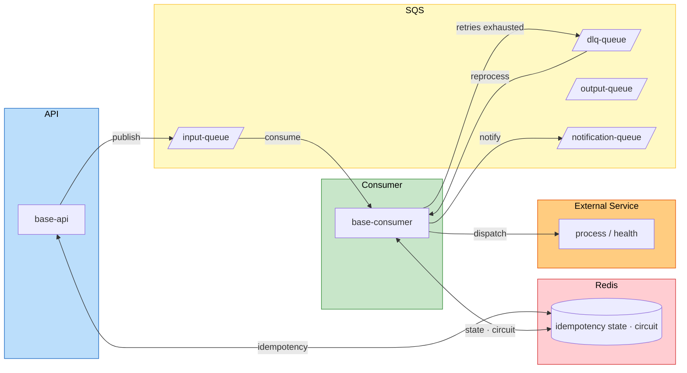

# Base Microservice

A template microservice built with Spring Boot following hexagonal architecture. Provides
a REST API for event ingestion and an asynchronous consumer for processing messages through
SQS queues, with Redis-backed circuit breaker, distributed locking, and full observability.

The project serves as a foundation for building event-driven microservices — clone it,
rename the modules, and adapt the domain logic to your business needs.

## Stack

- Java 25 & Spring Boot 4.0
- Maven Wrapper (`./mvnw`)

## Prerequisites

- JDK 25
- Maven 3.9+ (optional if using the wrapper)
- Docker 24+ (required for integration tests and containerized execution)

## How to run locally

The project is divided into two independent modules. Each can be executed separately:

### base-api (port 8080)
```bash
./mvnw spring-boot:run -pl base-api
```

### base-consumer (port 8082)
```bash
./mvnw spring-boot:run -pl base-consumer
```

### Build the jar
```bash
./mvnw clean package -pl base-api
./mvnw clean package -pl base-consumer
```

See required environment variables in [docs/desenvolvimento-local.md](docs/desenvolvimento-local.md).

## Testing

### Unit Tests
```bash
./mvnw test
```

### Integration Tests
Integration tests use **Testcontainers** to spin up real Docker containers (Redis) during execution.

**Prerequisites:**
- Docker installed and running

**Run only integration tests:**
```bash
./mvnw integration-test
```

**Run a specific test:**
```bash
./mvnw integration-test -Dit.test=CircuitBreakerEndToEndIT
```

**Run all tests (unit + integration + coverage):**
```bash
./mvnw verify
```

**Note:** Integration tests are identified by the suffix `*IT.java` and are executed by the Failsafe plugin, separate from unit tests.

## Minimal happy path (Docker Compose + Grafana)

Quick guide to bring up the environment and see metrics in Grafana end-to-end.

### 1. Start services

```bash
docker compose -f docker/dev/docker-compose.yml up -d --build
```

> The first Grafana start takes a few minutes (SQLite migration). Wait until
> `curl -s -o /dev/null -w "%{http_code}" http://localhost:3000/api/health` returns `200`.

### 2. Generate test data

Send messages through the API and observe processing:

```bash
# Normal flow (3 messages) — o "id" é o correlationId usado no tracing
for i in 1 2 3; do
  curl -s -X POST http://localhost:8080/events \
    -H "Content-Type: application/json" \
    -H "X-API-Key: dev-secret" \
    -d "{\"id\":\"evt-$i\",\"type\":\"TEST_EVENT\",\"data\":\"sample$i\"}"
done

# Failure: stop the external service mock and send messages that will fail
docker compose -f docker/dev/docker-compose.yml stop external-service-mock
for i in 4 5 6; do
  curl -s -X POST http://localhost:8080/events \
    -H "Content-Type: application/json" \
    -H "X-API-Key: dev-secret" \
    -d "{\"id\":\"evt-$i\",\"type\":\"TEST_EVENT\",\"data\":\"fail_sample$i\"}"
done

# Recovery: restore the external service (health probe closes the circuit and reprocesses)
docker compose -f docker/dev/docker-compose.yml start external-service-mock
```

### 3. View traces in Grafana

Access `http://localhost:3000` → folder "Base Microservice" → dashboard **"Base Microservice Overview"**.

No topo, cole um **Correlation ID** (o `id` do evento, ex.: `evt-1`) na variável `$correlationId`:

- **Tracing (Tempo) → "Waterfall API + Consumer (correlationId)"**: lista os traces daquele correlationId.
- Clique no **Trace ID** → menu com **"Abrir no Trace View (Drilldown)"** (renderiza o trace no painel embutido) ou **"Abrir na tela de Trace (Explore)"**.
- **"Trace View (Drilldown)"**: mostra o trace traversal — a API (`http post /events`) e o consumer (`base-consumer-input` / `base-consumer-dlq`) como **roots do MESMO trace** (traceId unificado via Redis), com os spans de Redis aninhados.
- **"Rastreamento por correlationId"** (Loki): logs da API e do consumer para o mesmo id.

> O `traceId` da API é gravado no Redis em `event:trace:<eventId>` e reaproveitado pelo consumer como root — por isso API e consumer aparecem no mesmo trace, sem propagação W3C pela fila.

## Docker

Container artifacts are organized in `docker/dev` and `docker/prd`.

```bash
# Build and run with Docker Compose
docker compose -f docker/dev/docker-compose.yml up --build

# Build image only
docker build -f docker/prd/Dockerfile -t base-microservice:latest .
```

The final image uses `eclipse-temurin:25-jre-alpine`, reducing attack surface and running as non-privileged user.

### Ports exposed in local environment (docker-compose)

| Service               | Host port  | Container port | Description                                         |
|-----------------------|------------|----------------|-----------------------------------------------------|
| `base-api`            | 8080       | 8080           | REST API                                            |
| `base-consumer`       | 8082       | 8080           | SQS Consumer (listens on 8080 internally, mapped to 8082) |
| `grafana`             | 3000       | 3000           | Anonymous auth enabled                              |
| `loki`                | 3100       | 3100           | Logs                                                |
| `tempo`               | 3200 / 4318 | 3200 / 4318   | Tracing (OTLP on 4318)                              |
| `localstack`          | 4566       | 4566           | SQS/SNS/S3 emulated                                 |
| `valkey`              | 6379       | 6379           | Redis-compatible cache                              |
| `external-service-mock` | 8888     | 8080           | Mock of external service (`/process` and `/health`) |
| `sqs-admin`           | 3999       | 3999           | UI for SQS send/receive                             |
| `redis-insight`       | 5540       | 5540           | Redis UI                                            |
| `adminer`             | 8090       | 8080           | MySQL UI                                            |

> Both modules listen on **8080** inside the container. In the local compose,
> the consumer is mapped to `8082:8080` to avoid conflicts with the API.

### Local observability (Grafana + Tempo + Loki)

- The `docker-compose` brings up Grafana, Tempo, Loki, Promtail, and the external service mock alongside the API and consumer. Grafana is available at `http://localhost:3000` with **anonymous auth** (no login).
- Loki and Tempo data sources are provisioned automatically in `docker/dev/grafana/provisioning/datasources/datasources.yaml`, including the `trace_id` link from logs to trace visualization.
- Structured logs are written to `/app/logs/consumer.log` and `/app/logs/api.log` (via `LOGGING_FILE_NAME`), which Promtail sends to Loki.
- OTLP traces sent to `http://localhost:4318` are captured by Tempo and available in Grafana with direct log correlation.

### LocalStack (SQS)

In the local environment, the service consumes SQS queues. The `docker/dev/docker-compose.yml` brings up LocalStack alongside the rest of the stack using a Community image that does not require a license token.

To run commands on LocalStack, use the Compose service name:

```bash
docker compose -f docker/dev/docker-compose.yml exec localstack \
  awslocal sqs list-queues --region us-east-1
```

Applications inside the Docker network use `http://localstack:4566` and queue URLs
also remain on this host.

### Queue names (local)

| Queue               | URL                                                             |
|---------------------|-----------------------------------------------------------------|
| `input-queue`       | `http://localstack:4566/000000000000/input-queue`               |
| `output-queue`      | `http://localstack:4566/000000000000/output-queue`              |
| `dlq-queue`         | `http://localstack:4566/000000000000/dlq-queue`                 |
| `notification-queue` | `http://localstack:4566/000000000000/notification-queue`       |

## Structured logging

All logs follow a consistent JSON payload:

```json
{
  "timestamp": "2026-06-09 12:54:48.085",
  "severity": "INFO",
  "correlation_id": "No Correlation ID",
  "detail": "STATS;INPUT;Q=0;Rcv=1;Sent=1;Lost=0;Pend=0;Rate=0/s",
  "request_id": "40a158bc-ae73-4cb1-b935-964f5358b2ce",
  "source": {
    "context": "BaseMicroservice"
  },
  "trace": {
    "exception": "No exception",
    "trace_id": "No Trace ID",
    "trace_msg": "No stack trace"
  }
}
```

Configuration is in `base-<module>/src/main/resources/logback-spring.xml`. Fields are populated via MDC (`org.slf4j.MDC`); set keys like `correlation_id`, `request_id`, `source.context`, etc. Safe defaults are applied when no value is set.

> **Loki4j 1.6.0**: label configuration uses `<format><label><pattern>` instead of `<labels>` as a direct element.
> The `local` profile does not use Loki4j — logs go to file and Promtail sends to Loki.
> In non-local profiles (`!local`), Loki4j sends directly to Loki with labels `job`, `app`, `env`, `component`.

Loki sending (profile `!local`) uses configurable batching via environment variables:

| Variable                | Default         | Description                                                |
|-------------------------|-----------------|------------------------------------------------------------|
| `LOKI_BATCH_MAX_ITEMS`  | `100`           | Max logs per batch before sending                          |
| `LOKI_BATCH_MAX_BYTES`  | `1048576` (1MB) | Max batch size                                             |
| `LOKI_BATCH_TIMEOUT_MS` | `5000`          | Time-based flush: sends pending after this interval        |

## Configuration

Variables and properties can be defined via `application.properties` or standard Spring Boot environment variables (`SPRING_*`).

- `AWS_REGION` (or `aws.region` in `application.properties`) must point to a valid region. If not provided, the service tries to infer the region from the queue URL (`AWS_SQS_QUEUE_URL`), but initialization will halt with a clear message if that's not possible. Always configure `AWS_REGION` in official environments.
- `AWS_LOCALSTACK_ENDPOINT` is used only in dev/local. In production, leave the variable empty or absent to use the standard AWS provider.

### Tuning and Performance

All throughput, connection pool, and timeout settings are exposed as **environment variables** and can be adjusted per environment without rebuild.

- **Tomcat**: `max-connections`, `accept-count`, `connection-timeout`, keep-alive, HTTP/2
- **Valkey/Redis (Lettuce)**: pool size (`max-active=64`, `max-idle=32`, `min-idle=8`), timeouts
- **AWS SQS Client**: synchronous HTTP pool (Apache) with `max-connections=100` and asynchronous (Netty) with `maxConcurrency=200`, retry with jitter, API timeouts
- **Graceful shutdown**: `server.shutdown=graceful`, `lifecycle.timeout-per-shutdown-phase=15s`

### External service connection (Apache HttpClient 5)

The external service RestClient uses `HttpComponentsClientHttpRequestFactory` with Apache HttpClient 5 and `PoolingHttpClientConnectionManager`, replacing the previous `SimpleClientHttpRequestFactory` which did not support pooling.

| Environment Variable                   | Property                        | Default | Description                                |
|----------------------------------------|----------------------------------|---------|--------------------------------------------|
| `EXTERNAL_SERVICE_URL_PROCESS`          | `external-service.url-process`   | —       | Processing endpoint (required)             |
| `EXTERNAL_SERVICE_URL_HEALTH`           | `external-service.url-health`    | —       | Health check endpoint (required for CB)    |
| `EXTERNAL_SERVICE_POOL_MAX_CONN_TOTAL`  | `external-service.pool.max-conn-total` | `50` | Max connections in pool               |
| `EXTERNAL_SERVICE_POOL_MAX_CONN_PER_ROUTE` | `external-service.pool.max-conn-per-route` | `20` | Max connections per route        |

## What The Service Does

- Exposes a REST API as an event entry point.
- Consumes SQS queues for asynchronous event processing.
- Maintains state and deduplication/cache in Redis or Valkey.
- Sends messages to an external service with retries and circuit breaker, using Apache HttpClient 5 with configurable connection pool.
- Exposes `/health` and `/actuator/health` endpoints for infrastructure probes (ALB/ECS).
- Publishes structured JSON logs and OTLP traces for log-trace correlation.

## Idempotency and Redis

Idempotency is guaranteed end-to-end by `correlationId`, with atomic barriers in three layers:

| Layer       | Module          | Redis Operation                       | Behavior                                         |
|-------------|-----------------|--------------------------------------|--------------------------------------------------|
| **Content** | `base-api`      | `SET NX EX operation:dedup:<hash>`   | Deduplicates repeated content within TTL         |
| **API**      | `base-api`      | `HSETNX apiReceived` on hash        | If correlationId exists → returns `200 OK`       |
| **Consumer** | `base-consumer` | `HSETNX eventId` on same hash       | If eventId exists → handles recovery flows       |

All operation state (status, metadata, idempotency) is consolidated in a **single Redis Hash** per `correlationId`. API and consumer share the same hash, ensuring end-to-end visibility.

## Main structure
```
src/main/java/br/com/finnet/microservice/
├── Application.java                # Spring Boot main class
├── infrastructure/config/          # Configurations
├── application/                    # Use cases and DTOs
├── domain/                         # Services, models, and ports
└── adapter/                        # Input and output adapters
```

## Architecture



### Flow

1. Client sends event via REST API to `base-api`.
2. API validates, resolves `correlationId`, publishes to SQS `input-queue`.
3. Consumer picks up the message → orchestrator → dispatches to external service.
4. External service adapter sends request with `@Retryable` and Circuit Breaker.
5. On permanent failure, message is sent to DLQ for later reprocessing.