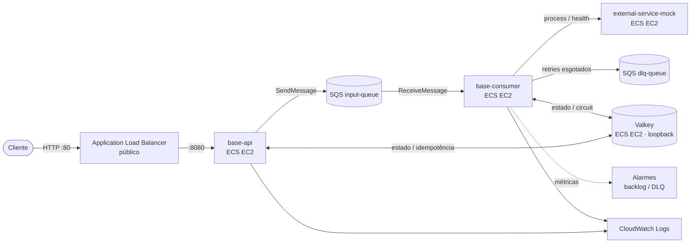

# Projeto Final — Infraestrutura AWS (Terraform)

Infraestrutura como código do projeto final: uma API Spring Boot que publica
eventos no Amazon SQS, um consumer que processa esses eventos com idempotência
em Redis/Valkey, retry, circuit breaker e um serviço HTTP externo simulado.

Toda a stack roda em **`sa-east-1`**, reaproveitando a **VPC e as sub-redes**
criadas no laboratório `04-vpc`. Nenhum recurso existente é recriado ou destruído.

## Arquitetura



Todos os containers são executados na **mesma capacidade EC2** do cluster ECS
(`host` network mode), em uma única AZ, com um IP público apenas para saída.

## Decisões de arquitetura

### 1. Redis/Valkey: container no ECS, na mesma capacidade EC2

| Opção | Custo contínuo | Persistência | Disponibilidade | Complexidade | Veredito |
|---|---|---|---|---|---|
| **Container Valkey no ECS (escolhida)** | **US$ 0 extra** | Em memória (aceitável) | Ponto único (ok p/ lab) | Baixa | ✅ Menor custo, reusa a capacidade |
| ElastiCache `cache.t4g.micro` | ~US$ 21,90/mês | RDB/AOF, backups | Multi-AZ opcional | Média | ❌ Custo fixo alto p/ portfólio |
| Serviço ECS separado em outra instância | +1 instância EC2 | Em memória | Ponto único | Média | ❌ Custo desnecessário |
| Redis na instância, fora do ECS | US$ 0 extra | Em memória | Ponto único | Baixa | ⚠️ Equivalente, menos consistente com o ECS |

**Recomendação:** Valkey como tarefa ECS na mesma capacidade, **privado**
(bind em `127.0.0.1` + `requirepass` + Security Group restrito à própria
instância). O estado guardado é idempotência/circuit breaker, que tolera perda
(ver Questão 9 do diagnóstico) — então não se justifica pagar ElastiCache.

### 2. Egress de rede sem NAT Gateway

As instâncias de capacidade ficam em **sub-rede pública com IP público**, usando
o Internet Gateway já existente para alcançar ECR, SQS, CloudWatch e ECS.
Isso evita NAT Gateway (proibido) e também VPC Interface Endpoints, que em
`sa-east-1` custam ~US$ 0,013/h **por endpoint por AZ** (vários endpoints
passariam de US$ 100/mês). O isolamento é feito por Security Group.

> Alternativa mais "rígida" (sub-redes privadas + VPC Endpoints de interface
> para `ecr.api`, `ecr.dkr`, `logs`, `sqs`, `ecs*` + Gateway Endpoint do S3)
> custa mais que o NAT Gateway neste cenário e foi descartada pelo objetivo de
> **menor custo**. Está documentada aqui apenas como referência de estudo.

### 3. ECS com capacidade EC2 (não Fargate)

Mantido por coerência com o laboratório `09-ecs` e o diagnóstico (Questão 10):
permite escolher a instância mais barata e estudar capacidade do cluster e
Auto Scaling. A capacidade é um **Auto Scaling Group** com instâncias
ECS-optimized (Amazon Linux 2023).

### 4. `host` network mode

Com `host`, os quatro containers compartilham a rede da instância: comunicam-se
por `localhost` sem mapeamento de portas e sem consumir ENIs extras (limite de
3 ENIs em `t3.small`). Portas: `base-api` 8080, `base-consumer` 8081, Valkey
6379, mock 8888. O ALB acessa `instance:8080` (target type `instance`).

## Recursos criados

| Categoria | Recursos |
|---|---|
| Rede | Security Groups (`alb`, `ecs-instances`) reutilizando a VPC existente |
| Load balancing | ALB público + listener HTTP:80 + target group (`instance`, `/health`) |
| Compute | Cluster ECS, Launch Template, Auto Scaling Group (1 × `t3.small`), 4 task definitions, 4 services |
| Mensageria | `input-queue` (long polling, redrive) + `dlq-queue` |
| Imagens | 2 repositórios ECR + lifecycle policy |
| Segredos | SSM SecureString (`api-key`, `valkey-url`, `valkey-password`) gerados por `random_password` |
| IAM | Instance role, task execution role, API task role, consumer task role |
| Observabilidade | 4 log groups (retenção 3 dias) + 2 alarmes (backlog e DLQ) |

## IAM — least privilege

### Roles da aplicação (execução)

Papéis criados para o runtime, cada um com o mínimo necessário:

- `aws-cloud-practitioner-lab-final-ec2` — ECS agent nas instâncias (`AmazonEC2ContainerServiceforEC2Role`).
- `aws-cloud-practitioner-lab-final-task-execution` — pull no ECR + logs (`AmazonECSTaskExecutionRolePolicy`) + leitura **apenas** dos 3 parâmetros SSM do projeto.
- `aws-cloud-practitioner-lab-final-api-task` — apenas `sqs:SendMessage`/`GetQueueUrl`/`GetQueueAttributes` na fila de entrada.
- `aws-cloud-practitioner-lab-final-consumer-task` — `ReceiveMessage`/`DeleteMessage`/`ChangeMessageVisibility`/`GetQueueAttributes`/`GetQueueUrl` apenas nas duas filas do projeto.

### Policy de deploy (identidade que roda o Terraform)

O usuário `aws-cloud-practitioner-lab` tinha `AdministratorAccess`. Para remover
essa dependência, `iam-deployer.tf` cria a policy scoped
**`aws-cloud-practitioner-lab-final`** e a anexa ao usuário. Ela:

- usa apenas as ações dos serviços deste projeto (EC2, ELB, Auto Scaling, ECS, ECR, SQS, SSM, Logs, Alarms, IAM, STS, KMS);
- escopa por recurso o que a AWS permite: ECR/SQS/SSM pelo prefixo do projeto, roles por `role/aws-cloud-practitioner-lab-final-*`, instance profiles por prefixo equivalente, e as policies de IAM por `policy/aws-cloud-practitioner-lab-final*`;
- restringe `iam:PassRole` às roles do projeto e somente para `ecs-tasks.amazonaws.com` e `ec2.amazonaws.com`;
- limita a criação de service-linked roles a ECS, Auto Scaling e ELB;
- deixa em `Resource = "*"` somente as ações de **create/describe** que a AWS não permite escopar (ex.: `ec2:CreateSecurityGroup`, `elasticloadbalancing:*`).

As policies dos laboratórios anteriores **permanecem** (decisão: manter e apenas somar).

> **Risco residual (documentado):** sem uma *permissions boundary*, uma policy de
> deploy que pode criar/alterar roles e a própria policy permite, em tese,
> escalonamento de privilégio (ex.: `iam:AttachUserPolicy`/`CreatePolicyVersion`).
> Mitigação definitiva: aplicar uma **permissions boundary** a todas as roles e à
> própria identidade de deploy. Fica como evolução opcional (não escolhida para
> manter a solução simples).

### Bootstrap (uma única vez)

A policy de deploy **não pode criar a si mesma sem permissão**. Por isso:

1. Mantenha o `AdministratorAccess` anexado e rode `terraform apply` — isso cria a
   policy `aws-cloud-practitioner-lab-final` e a anexa ao usuário.
2. Remova o `AdministratorAccess`.
3. Confirme com `terraform plan` que tudo continua planejável só com a policy scoped.

## Pré-requisitos

- Terraform >= 1.5 e AWS CLI autenticado como `aws-cloud-practitioner-lab`.
- VPC e sub-redes públicas do laboratório `04-vpc` existentes.
- Docker para build das imagens.

## Ordem de execução

> **Bootstrap do IAM:** o primeiro `apply` deve rodar com o `AdministratorAccess`
> ainda anexado (ele cria a policy de deploy scoped e a anexa ao usuário). Só
> depois remova o `AdministratorAccess`.

```bash
cd 13-final-project/infra

# 1. Provisionar a infraestrutura (cria ECR, SQS, ECS, ALB, IAM, logs, policy de deploy)
terraform init
terraform plan
terraform apply

# 2. Build e push das imagens (os serviços começam a subir após o push)
AWS_REGION=sa-east-1
ACCOUNT_ID=$(aws sts get-caller-identity --query Account --output text)
REGISTRY="$ACCOUNT_ID.dkr.ecr.$AWS_REGION.amazonaws.com"
aws ecr get-login-password --region $AWS_REGION | docker login --username AWS --password-stdin "$REGISTRY"

cd ../final_project
docker build -f docker/dev/Dockerfile-api -t "$REGISTRY/aws-cloud-practitioner-lab-final-api:latest" .
docker build -f docker/dev/Dockerfile     -t "$REGISTRY/aws-cloud-practitioner-lab-final-consumer:latest" .
docker push "$REGISTRY/aws-cloud-practitioner-lab-final-api:latest"
docker push "$REGISTRY/aws-cloud-practitioner-lab-final-consumer:latest"

# 3. Testar (a API exige o header X-API-Key)
ALB=$(cd ../infra && terraform output -raw alb_dns_name)
API_KEY=$(aws ssm get-parameter --name /aws-cloud-practitioner-lab/final/api-key \
  --with-decryption --query Parameter.Value --output text --region sa-east-1)
curl -X POST "http://$ALB/events" \
  -H "Content-Type: application/json" -H "X-API-Key: $API_KEY" \
  -d '{"id":"evt-1","type":"TEST_EVENT","data":"sample1"}'
```

> Enquanto as imagens não forem enviadas, as tarefas do ECS ficam em erro de
> pull e o ECS tenta novamente automaticamente. Basta aguardar após o push.

## Estimativa de custos (`sa-east-1`, sob demanda)

Preços reais consultados na API de Pricing da AWS (podem mudar):

| Recurso | Preço unitário | Uso estimado/mês | Custo/mês |
|---|---|---|---|
| ALB | US$ 0,034/h + LCU US$ 0,011/h | 730 h + ~1 LCU | ~US$ 25 – 33 |
| EC2 `t3.small` | US$ 0,0336/h | 730 h | ~US$ 24,53 |
| EBS gp3 (raiz 30 GB) | US$ 0,152/GB-mês | 30 GB | ~US$ 4,56 |
| CloudWatch Logs | US$ 0,90/GB ingerido + US$ 0,0408/GB-mês | < 1 GB | < US$ 1 |
| CloudWatch Alarms | US$ 0,10/alarme-mês | 2 alarmes | US$ 0,20 |
| ECR storage | US$ 0,10/GB-mês | ~1 GB | ~US$ 0,10 |
| SQS | US$ 0,38/milhão | baixo volume | ~US$ 0 |
| **Total (se deixado ligado)** | | | **~US$ 55 – 65/mês** |

**Valkey como container: custo adicional US$ 0.** Com ElastiCache
`cache.t4g.micro` seriam **+ US$ 21,90/mês**.

> ⚠️ **Não existe custo zero**: o ALB e a instância EC2 cobram por hora mesmo
> ociosos. Destrua a stack ao terminar. A variante `t3.micro` (US$ 0,0168/h,
> ~US$ 12,26/mês) economiza, mas tem só 1 GiB de RAM — arriscado para 4
> containers.

## Segurança

- ALB: ingress apenas `:80` da internet.
- Instâncias: `:8080` somente do SG do ALB; `:6379`, `:8081`, `:8888` somente do próprio SG.
- Valkey: `--bind 127.0.0.1` + `--requirepass` (senha em SSM SecureString).
- Segredos injetados via `secrets` do ECS — nunca no task definition.
- IMDSv2 obrigatório nas instâncias (`http_tokens = "required"`).
- SQS com SSE gerenciado; ECR com scan on push.
- Estado do Terraform é local e está no `.gitignore` (contém valores sensíveis).

## Destruir

```bash
cd 13-final-project/infra
terraform destroy
```

Depois, confirme que não restaram recursos cobrados (ALB, EC2, EBS, ECR, SSM,
log groups) no console/CLI.
